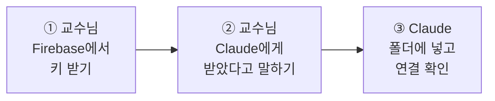

# Firebase 키 넣기 (5분)

사이트와 Firebase를 이미 만드셨다면, **키 파일을 한 번만 받으면 됩니다.** 파일을 옮기고 설정하는 일은 Claude가 합니다.



## 키가 무엇인가요?

키는 **Claude가 교수님의 Firebase 데이터 창고에 들어갈 때 쓰는 열쇠**입니다. 파일 하나로 되어 있습니다.

처음 한 번만 넣으면, 그다음부터는 Claude가 이 열쇠로 강의 자료와 초고를 관리자 페이지에 저장합니다.

| 하려는 일 | 키가 필요한가요? |
|---|---|
| 초고 만들기 | 아니요. 키가 없으면 내 컴퓨터에만 저장됩니다 |
| 자료와 초고를 **관리자 페이지**에 저장하기 | **네** |
| 관리자 페이지에서 글을 **사이트에 게시**하기 | 아니요. 구글 로그인으로 합니다 |

---

## 1단계. Firebase에서 키 받기 (교수님)

1. **[Firebase 키 화면 열기](https://console.firebase.google.com/project/_/settings/serviceaccounts/adminsdk)** 를 누릅니다.
2. 구글 로그인을 하고, 프로젝트를 고르라고 하면 **내 사이트를 만든 프로젝트**를 누릅니다.
3. 화면 아래쪽의 **새 비공개 키 생성** 버튼을 누릅니다.
4. 안내 창이 뜨면 **키 생성**을 누릅니다.

파일 하나가 **다운로드 폴더**에 저장됩니다. 파일을 열거나 이름을 바꾸지 말고 그대로 두세요.

> 화면이 다르면: 왼쪽 위 **톱니바퀴(⚙) → 프로젝트 설정 → 서비스 계정** 탭으로 들어가세요. 메뉴 이름은 조금 다를 수 있습니다.

## 2단계. Claude에게 말하기 (교수님)

이 폴더에서 켠 Claude에게 이렇게 입력합니다.

```
Firebase 키 받았어요. 넣어 주세요.
```

## 3단계. 결과 확인하기 (Claude)

Claude가 키를 다운로드 폴더에서 찾아 `keys/` 폴더로 옮기고, 설정 파일(`.env`)을 만든 뒤 연결을 확인합니다. 실행해도 되는지 묻는 창이 나오면 **허용**을 눌러 주세요.

**"연결 성공"** 이라는 답이 오면 끝입니다.

---

## 꼭 지켜 주세요

키는 **내 데이터 창고의 마스터키**입니다. 가진 사람은 저장된 자료를 읽고 지울 수 있습니다.

- ❌ 메일이나 메신저로 보내지 마세요.
- ❌ Claude 채팅창에 파일 내용을 붙여 넣지 마세요.
- ❌ GitHub에 직접 올리지 마세요.

`keys/` 폴더는 이 저장소의 설정(`.gitignore`)에 따라 GitHub에 올라가지 않습니다.

**유출된 것 같다면** Firebase 키 화면의 Google Cloud 링크에서 서비스 계정을 열어 **그 키를 삭제**하세요. 그다음 1단계부터 새 키를 받고 Claude에게 **"키를 새것으로 바꿔 주세요"** 라고 하면 됩니다.

## 잘 안 될 때

| 이런 말이 나오면 | 이렇게 하세요 |
|---|---|
| **키 없음** | 파일이 다운로드 폴더에 있는지 보세요. 다른 곳에 저장됐다면 다운로드 폴더로 옮기고 다시 말씀해 주세요 |
| **프로젝트 불일치** | 다른 프로젝트의 키를 받은 경우입니다. 사이트를 만든 프로젝트를 골라 다시 받으세요 |
| **키 무효** 또는 **키 읽기 실패** | 1단계부터 새 키를 받고 **"키를 새것으로 바꿔 주세요"** 라고 하세요 |
| **Firestore 없음** | Firebase 왼쪽 메뉴의 **빌드 → Firestore Database**에서 **데이터베이스 만들기**를 누르세요. 위치는 `asia-northeast3 (서울)`, 모드는 **프로덕션 모드**입니다 |
| **새 비공개 키 생성**을 눌렀는데 오류가 남 | 학교 계정은 관리자가 막아 두었을 수 있습니다. 프로젝트를 만든 개인 구글 계정으로 로그인했는지 확인하세요 |

---

**다음 할 일:** Claude가 이어서 안내합니다. 안내가 멈췄다면 **"다음은 뭐 해요?"** 라고 하세요.
