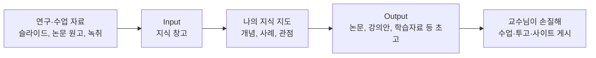

# 교수 지식 자산화 스튜디오

교수님의 강의·연구·글을 모아 **교수님만의 지식 지도**로 정리하고, 그것을 근거로 **강의안·학습자료·평가문항·칼럼·교재 초안**까지 만들어 주는 **Claude Code 작업 폴더**입니다. 한 학기 강의, 논문 한 편, 칼럼 하나가 끝나고 흩어지지 않고, 찾아 쓰고 다시 만들 수 있는 **자산**으로 쌓이게 하는 것이 목적입니다.

**사이트를 이미 만들고 Firebase도 연동하신 교수님을 위한 폴더입니다.** 그 사이트에 **Input과 Output**을 더해, 연구·수업 자료를 모으고 초고를 쌓는 자동화 시스템을 만듭니다.



Input과 Output은 내 사이트의 관리자 페이지에서 교수님만 로그인해 봅니다.

## 처음이세요? Claude가 순서대로 안내합니다

**무엇을 해야 할지 외우지 않으셔도 됩니다.** 아래 3줄을 입력하면 Claude가 현재 상태를 보고 무엇을, 왜, 어떻게 하는지 한 단계씩 알려 드립니다. 한 단계가 끝나면 다음 단계로 이어서 안내합니다.

```
git clone https://github.com/philosophyAIEDU/261021educontents.git my-knowledge
cd my-knowledge
claude "시작해 주세요"
```

| 단계 | 하는 일 | 교수님이 하실 일 |
|---|---|---|
| ① 준비 | 프로그램 설치, 프로필 | 이름과 전공 알려 주기 |
| ② 연결 | 이미 만든 사이트·Firebase에 이 폴더를 연결 | [키 받기 (5분)](FIREBASE_KEY_GUIDE.md), 관리자 페이지 로그인 |
| ③ 자산화 | 자료를 Input에, 초고를 Output에 | `raw/` 폴더에 자료 넣기 |
| ④ 자동화 | 매주 자동 실행 | 언제 돌릴지 정하기 |

초고는 **"20% 고칠 게 남은 상태"** 입니다. 공개하고 싶은 글은 관리자 페이지에서 **사이트에 게시**를 누르면 내 사이트의 '글'에 나옵니다.

## 전체 흐름

```
⓪ 한 번에           ①~⑤를 한 번에: raw/ 의 자료 → 자료별 초고                                   /make
① 모으기 (지식 창고)  슬라이드(.pptx)·한글(.hwpx)·워드·PDF·강의 녹취·유튜브·블로그를 정리해 올린다   /ingest
                      학생 질문·강의평가 서술형은 이름·학번을 지우고 질문 유형으로 분류한다         /ingest-questions
② 분석               나의 강의 말투와 잘 통한 수업 전개를 찾는다                                   /analyze-style
③ 지식 지도           나의 개념 정의·설명 틀·사례·관점·학생들이 막히는 곳·아직 기록 안 된 영역     /knowledge-map
④ 아이디어            모아 둔 자료로 다음에 만들 결과물 5개를 제안한다                              /asset-ideas
⑤ 결과물              강의안·학습자료·평가문항·칼럼·블로그·영상대본·교재 초고 → 검수 → 보관       /draft
⑥ 확인·공개          관리자 페이지에서 지식 창고와 결과물을 보고, 공개할 글은 사이트에 게시한다     (관리자 페이지)
   자동               /make 를 질문 없이, 매주 예약 실행                                           /auto
```

결과물은 완성본이 아니라 **"20% 고칠 게 남은 초고"** 입니다. 사실·인용·정답 확인과 마지막 손질, 수업에서의 사용은 언제나 교수님이 합니다.

## 이런 점이 다릅니다
- **교수님 자료 그대로 넣으면 됩니다.** PowerPoint(발표자 노트 포함), 한글(.hwpx), 워드, PDF, 자막(.srt), 녹음 전사 텍스트를 `raw/` 폴더에 넣거나, 유튜브 강의·블로그·칼럼 링크를 주면 됩니다.
- **교수님만의 지식 지도를 만듭니다.** 교과서 정의가 아니라 *교수님이 설명하는 방식*, 즐겨 드는 사례, 일관된 관점, 학생들이 자주 틀리는 개념, 아직 기록되지 않은 영역을 근거 자료와 함께 `knowledge-map.md`에 정리합니다.
- **하나의 자료가 여러 결과물이 됩니다.** 강의 녹취 하나로 학습자료와 평가문항을, 연구 메모나 논문으로 새 논문 초고·칼럼·학부생용 읽기자료를, 여러 주차 강의로 교재 한 장을 만듭니다. 논문 초고의 없는 데이터는 지어내지 않고 `[데이터 필요]`로 표시합니다.
- **지어내지 않습니다.** 사실·연구 결과·참고문헌은 교수님이 올린 자료에 있는 것만 씁니다. 없으면 `[출처 확인 필요]`, `[참고문헌 추가 필요]`로 표시합니다. 존재하지 않는 논문을 만들어 내지 않도록 별도 검수 에이전트가 모든 인용을 대조합니다.
- **평가문항은 정답 근거와 함께.** 문항마다 측정 목표, 정답, 정답이 나온 자료, 오답이 노리는 오개념을 적습니다.
- **학생 정보를 지킵니다.** 강의 녹취 속 학생 이름, 질문 작성자의 이름·학번·이메일·성적은 올리기 전에 지우고, 스크립트와 검수 에이전트가 두 번 확인합니다.
- **교수님 말투로 씁니다.** `voice.md`(말투)와 `structure.md`(잘 통한 전개)를 교수님 자료에서 뽑아 초고의 기준으로 씁니다.

## 다시 켤 때

이 폴더에서 `claude`를 켜고 새 자료를 `raw/` 폴더에 넣은 뒤 **`/make`** 라고 하세요. 무엇을 할지 모르겠으면 언제든 **"다음은 뭐 해요?"** 라고 하면 됩니다. 자세한 설명은 **[TUTORIAL.md](TUTORIAL.md)**.

> 아직 사이트가 없다면 Claude에게 **`/create-site`** 라고 하세요. **이미 있는 사이트에는 실행하지 마세요.** 다른 곳에서 만든 사이트가 덮어써집니다.

준비물: 이미 만든 내 사이트와 Firebase 프로젝트, [Claude Code](https://claude.com/claude-code), [Node.js](https://nodejs.org) 20.6 이상. 선택: 유튜브 강의를 가져오려면 [yt-dlp](https://github.com/yt-dlp/yt-dlp), PDF를 빨리 읽으려면 poppler(`pdftotext`).

## 명령어는 9개면 충분합니다

| 명령어 | 하는 일 |
|---|---|
| `/make` | **raw/ 의 자료를 모아 자료별 초고를 한 번에 뽑는다** (처음이면 이것만) |
| `/start` | 지금 몇 단계인지 보고 처음부터 끝까지 순서대로 안내한다. 교수 프로필 설정 |
| `/site` | **이미 있는** 내 사이트(GitHub 저장소)에 관리자 페이지만 넣는다 |
| `/ingest` | 강의자료·녹취·논문·칼럼·유튜브 강의를 가져와 지식 창고에 올린다 |
| `/analyze-style` | 내 말투(`voice.md`)와 잘 통한 전개(`structure.md`)를 채운다 |
| `/knowledge-map` | 내 지식 지도(`knowledge-map.md`)를 만들고 새 자료로 갱신한다 |
| `/asset-ideas` | 다음에 만들 결과물 후보 5개 |
| `/draft <종류> <주제·자료id>` | 초고 → 자동 검수 → 결과물 저장 (강의안·학습자료·평가문항·칼럼·블로그·영상대본·교재·논문) |
| `/auto` | `/make`를 질문 없이 (매주 예약 실행) |

그 밖의 명령(`/ingest-questions`, `/feedback`, `/monthly-review`, `/audit`, `/create-site` 등)은 `/menu`에서 볼 수 있습니다.

## 폴더 안내

| 폴더·파일 | 역할 |
|---|---|
| `profile.md` | 이름·소속·전공·담당 과목·학습자·내 주소. `/start`가 채움 |
| `raw/` | 원본 자료를 넣는 곳 (수정하지 않고, git에 올라가지 않음). 학생 질문은 `raw/questions/` |
| `processed/` | 정리·태깅된 자료 (지식 창고에 올라가는 JSON) |
| `knowledge-map.md` | 나의 지식 지도 (`/knowledge-map`이 채움) |
| `voice.md`, `structure.md` | 내 말투, 잘 통한 전개 (`/analyze-style`이 채움) |
| `drafts/` | 결과물 초고 (`lesson/` 강의안, `handout/` 학습자료, `quiz/` 평가문항, `column/`, `blog/`, `script/`, `book/`, `paper/` 논문, `weekly/`) |
| `site-content.md` | 내 사이트에 보일 내용 (소개·연구·강의·논문·연락처). **공개됨** |
| `site-assets/` | 사이트 사진 (`photo.jpg`) |
| `site-template/` | 사이트 모양 (HTML·CSS). 색은 `style.css`의 `:root` |
| `site/` | `/create-site`가 만드는 사이트 결과물 (git에 올라가지 않음) |
| `admin/index.html` | 관리자 페이지 원본 (사이트에 `knowledge-admin.html`로 함께 올라감) |
| `scripts/` | 가져오기·문서 변환·업로드·검수·사이트 설치 스크립트 (Claude가 알아서 실행) |
| `reports/` | 작업 기록 |
| `firestore.rules` | Firebase 보안 규칙 (지식 창고·결과물은 나만, 게시한 글은 누구나 읽기). `/create-site`가 내 이메일을 넣어 올림 |
| `.claude/` | Claude Code용 명령어(스킬), 검수 에이전트, 권한 설정 |
| `CLAUDE.md`, `GUIDE_FOR_CLAUDE.md` | Claude가 매번 읽는 규칙과 안내 방법 |
| `examples/` | 연습용 예시 강의 녹취와 학생 질문 (가상) |

## 꼭 지켜 주세요
- **서비스 계정 키(`keys/`)와 `.env`는 절대 GitHub에 올리지 마세요.** `.gitignore`가 막아 주지만, 그 설정을 지우지 마세요.
- **`site-content.md`는 공개 사이트에 그대로 나옵니다.** 학생 정보, 휴대전화 번호, 미발표 연구는 넣지 마세요. 사이트에 글을 게시하는 것은 언제나 교수님이 관리자 페이지에서 직접 합니다.
- 자료를 넣은 뒤 이 폴더를 GitHub에 올린다면 **private 저장소**로 두세요 (`voice.md`·`knowledge-map.md`에 교수님의 문장과 지식이 들어갑니다). 내 **사이트** 저장소에는 관리자 페이지 파일 하나만 들어갑니다.
- **교수님이 직접 만든 자료만** 넣으세요. 타인의 논문·교재·슬라이드, 유료 자료는 넣지 않습니다. 출판된 논문은 출판사 저작권 정책을, 공저 자료는 공저자 동의를 먼저 확인하세요.
- **학생 성적·출석부·상담 기록은 넣지 마세요.** 학생 질문은 이름·학번을 지운 질문 내용만 씁니다. 소속 학교의 개인정보 지침이 있으면 그것을 따르세요.

## 출처와 라이선스
[philosophyAIEDU/260927contents](https://github.com/philosophyAIEDU/260927contents)(크리에이터용 콘텐츠 스튜디오 스타터)를 교수·교육자의 지식 자산화용으로 바꾼 것입니다. MIT License. 자유롭게 쓰고 고쳐도 됩니다.
